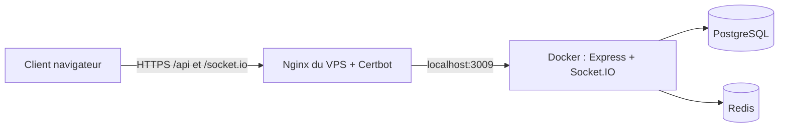

# Architecture initiale

Le port hôte est configurable. PostgreSQL et Redis sont sur un réseau Docker interne, sans ports publiés dans la configuration de production.

## Organisation du back-end

- `src/app.ts` : application HTTP sans ouverture de port, testable avec Supertest.
- `src/server.ts` : démarrage, connexions aux dépendances et arrêt gracieux.
- `src/config/` : validation de configuration et construction des URL sans journaliser les secrets.
- `src/http/` : contrat OpenAPI initial.
- `src/infrastructure/` : connexions PostgreSQL/Redis, actuellement utilisées pour la readiness.
- `src/realtime/` : serveur Socket.IO ; connexions refusées tant que l'authentification n'est pas implémentée.
- `src/modules/` : comptes, salons, moteur de jeu, chat et statistiques, encore non implémentés.
- `prisma/` : schéma vide et emplacement des migrations. Ajouter les modèles après validation ; les repositories métier utiliseront Prisma.

## étapes suivantes

Sessions Redis, Argon2id, protection CSRF et limitation des requêtes seront ajoutés avec les comptes et actions métier. Aucun endpoint métier n'est exposé actuellement.

L'instrumentation OpenTelemetry/Jaeger, l'adaptateur Redis Socket.IO et le déploiement de plusieurs instances restent à implémenter. La configuration actuelle lance une seule instance : Nginx agit comme reverse proxy, sans répartition effective entre plusieurs serveurs. Le load balancing demandé dans le cours nécessitera une étape dédiée.

Les tests Vitest vérifient le socle sans vraie base de données. La CI prévoit un démarrage Docker avec PostgreSQL/Redis et une vérification de readiness. Prévoir des tests d'intégration métier lors de l'ajout des repositories.

## Audit initial des dépendances

Au 18 novembre 2026, `npm audit` signale une vulnérabilité ReDoS de `picomatch` (GHSA-fc5q-39xc-vjpf), propagée par les outils de développement Vitest/Vite et typescript-eslint. Le registre consulté ne propose pas de version corrigée : la dernière version publiée est 4.0.7, incluse dans la plage affectée. Ne pas appliquer de rétrogradation automatique forcée ; suivre la publication du correctif et relancer les tests après mise à jour.

Ces dépendances ne sont pas installées dans l'image runtime (`npm ci --omit=dev`). L'audit de production doit être vérifié séparément avec `npm audit --omit=dev`. Ne pas exposer de serveur de tests ou d'outillage de développement sur le VPS.

## Vérifications du socle en local

Types, lint, huit tests, compilation et validation Prisma vérifiés. Les configurations Compose de production et de développement sont valides. L'audit des dépendances de production ne signale aucune vulnérabilité au 18 novembre 2026.

La construction et le démarrage Docker n'ont pas pu être vérifiés sur la machine de préparation : le moteur Docker Desktop Linux était arrêté. Le workflow CI contient ces vérifications ; leur résultat ne sera connu qu'après son exécution sur GitHub.
