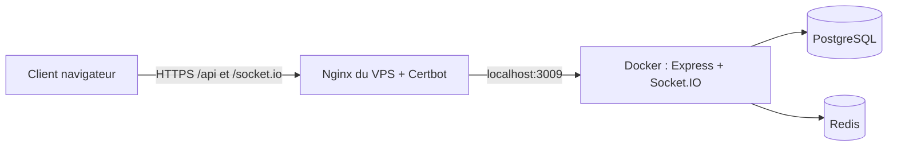

# Architecture initiale

Le port h?te est configurable. PostgreSQL et Redis sont sur un r?seau Docker interne, sans ports publi?s dans la configuration de production.

## Organisation du back-end

- `src/app.ts` : application HTTP sans ouverture de port, testable avec Supertest.
- `src/server.ts` : d?marrage, connexions aux d?pendances et arr?t gracieux.
- `src/config/` : validation de configuration et construction des URL sans journaliser les secrets.
- `src/http/` : contrat OpenAPI initial.
- `src/infrastructure/` : connexions PostgreSQL/Redis, actuellement utilis?es pour la readiness.
- `src/realtime/` : serveur Socket.IO ; connexions refus?es tant que l'authentification n'est pas impl?ment?e.
- `src/modules/` : comptes, salons, moteur de jeu, chat et statistiques, encore non impl?ment?s.
- `prisma/` : sch?ma vide et emplacement des migrations. Ajouter les mod?les apr?s validation ; les repositories m?tier utiliseront Prisma.

## ?tapes suivantes

Sessions Redis, Argon2id, protection CSRF et limitation des requ?tes seront ajout?s avec les comptes et actions m?tier. Aucun endpoint m?tier n'est expos? actuellement.

L'instrumentation OpenTelemetry/Jaeger, l'adaptateur Redis Socket.IO et le d?ploiement de plusieurs instances restent ? impl?menter. La configuration actuelle lance une seule instance : Nginx agit comme reverse proxy, sans r?partition effective entre plusieurs serveurs. Le load balancing demand? dans le cours n?cessitera une ?tape d?di?e.

Les tests Vitest v?rifient le socle sans vraie base de donn?es. La CI pr?voit un d?marrage Docker avec PostgreSQL/Redis et une v?rification de readiness. Pr?voir des tests d'int?gration m?tier lors de l'ajout des repositories.

## Audit initial des d?pendances

Au 18 novembre 2026, `npm audit` signale une vuln?rabilit? ReDoS de `picomatch` (GHSA-fc5q-39xc-vjpf), propag?e par les outils de d?veloppement Vitest/Vite et typescript-eslint. Le registre consult? ne propose pas de version corrig?e : la derni?re version publi?e est 4.0.7, incluse dans la plage affect?e. Ne pas appliquer de r?trogradation automatique forc?e ; suivre la publication du correctif et relancer les tests apr?s mise ? jour.

Ces d?pendances ne sont pas install?es dans l'image runtime (`npm ci --omit=dev`). L'audit de production doit ?tre v?rifi? s?par?ment avec `npm audit --omit=dev`. Ne pas exposer de serveur de tests ou d'outillage de d?veloppement sur le VPS.

## V?rifications du socle en local

Types, lint, huit tests, compilation et validation Prisma v?rifi?s. Les configurations Compose de production et de d?veloppement sont valides. L'audit des d?pendances de production ne signale aucune vuln?rabilit? au 18 novembre 2026.

La construction et le d?marrage Docker n'ont pas pu ?tre v?rifi?s sur la machine de pr?paration : le moteur Docker Desktop Linux ?tait arr?t?. Le workflow CI contient ces v?rifications ; leur r?sultat ne sera connu qu'apr?s son ex?cution sur GitHub.
