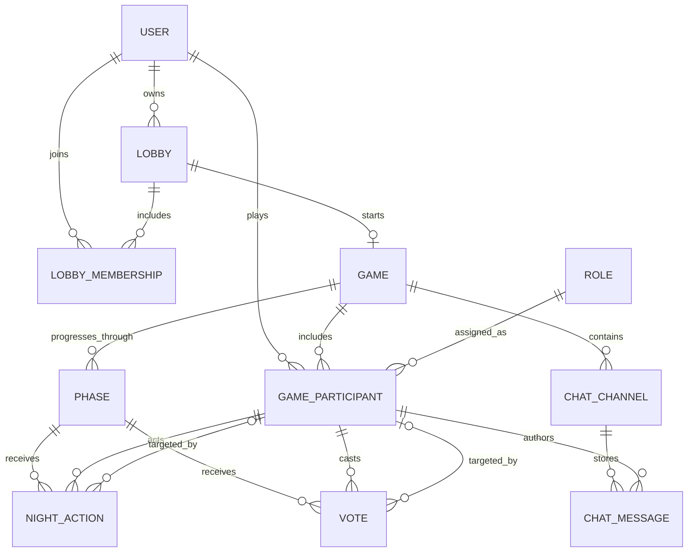

# Modèle conceptuel de données — première version

Statut : conception cible, partiellement implémentée pour USER, LOBBY et LOBBY_MEMBERSHIP. Ces trois entités ont leurs modèles Prisma et migrations ; les entités de partie restent à implémenter. Le champ technique usernameKey assure l’unicité insensible à la casse et n’est pas exposé par l’API. Ce document décrit des entités, attributs métier et cardinalités ; les types SQL, index et migrations seront conçus lors de l'implémentation.

Référence : [spécifications](specifications.md).

## Entités et attributs conceptuels

| Entité | Identité et principaux attributs | Responsabilité |
| --- | --- | --- |
| USER | Identifiant, pseudonyme, e-mail, empreinte de mot de passe, date de création | Compte ; jamais de mot de passe en clair |
| LOBBY | Identifiant, nom, visibilité, code privé protégé, état, capacité, trois durées | Groupe en attente ; créateur/propriétaire courant |
| LOBBY_MEMBERSHIP | Identifiant, date d'entrée, date de sortie éventuelle | Présence dans le salon, indépendante de la présence réseau |
| GAME | Identifiant, état, début, fin, camp gagnant éventuel, copie des durées | Partie unique d'un salon |
| ROLE | Code, nom, camp | Catalogue initial VILLAGER, WEREWOLF, SEER ; pas de système de pouvoirs arbitraires |
| GAME_PARTICIPANT | Identifiant, état vivant/mort, date d'élimination, pseudonyme de participation | Joueur d'une partie et rôle figé |
| PHASE | Identifiant, numéro de cycle, type, début, échéance, résolution éventuelle | Nuit, débat ou vote ; un seul état courant par partie |
| NIGHT_ACTION | Identifiant, nature, validation, éventuel résultat privé d'inspection | Choix d'un acteur de nuit, avec cible facultative pour abstention |
| VOTE | Identifiant, date de validation | Bulletin du village, cible facultative pour abstention |
| CHAT_CHANNEL | Identifiant, type PUBLIC/WOLVES/DEAD/POST_GAME | Canal d'une seule partie |
| CHAT_MESSAGE | Identifiant, identifiant client de déduplication, contenu, date serveur | Message immuable attribué à un participant et un canal |

Une session d'authentification est stockée dans Redis : elle référence USER sans constituer une table PostgreSQL du MCD. Les statistiques sont calculées à partir des parties terminées et de leurs participants, et les réponses publiques peuvent être mises en cache ; ne pas créer une deuxième vérité pour les résultats.

## Associations et cardinalités

Notation : `||` exactement un, `o|` zéro ou un, `o{` zéro à plusieurs. Un salon vide peut être conservé fermé ; un objet en cours de création peut n'avoir encore aucune phase ou participation dans le diagramme. Les invariants de lancement ci-dessous imposent l'effectif de la partie réellement démarrée.

LOBBY est lié exactement à un propriétaire USER, y compris après fermeture ; la propriété peut être transférée avant le départ. GAME_PARTICIPANT relie exactement un USER, une GAME et un ROLE. Une cible facultative concerne chaque action ou bulletin ; une même personne peut être visée par plusieurs actions ou bulletins.

## Invariants à traduire en contraintes et services

- Une seule appartenance active par couple utilisateur/salon. Un départ ne supprime pas l'historique d'appartenance.
- Un propriétaire de salon ouvert est membre actif ; son départ explicite transfère la propriété ou ferme le salon.
- Une seule GAME par LOBBY en V1. Au lancement, copier les 6 à 12 membres dans des participations uniques par couple utilisateur/partie, sans imposer de dépendance à une connexion réseau.
- Les effectifs du catalogue de rôles correspondent au nombre de participants au départ. Le rôle d'un participant ne change pas pendant la partie.
- Une PHASE appartient à une partie. Une seule phase non résolue à la fois ; chaque phase est résolue au plus une fois. Début, échéance et résolution sont persistés.
- Une seule NIGHT_ACTION par acteur et nuit ; sa nature doit correspondre au rôle. Une seule VOTE par votant et phase de vote. L'absence de ligne est distincte d'une abstention explicitement validée sans cible.
- Acteur et cible éventuelle appartiennent à la même partie que la phase. Le domaine valide leur état vivant et les règles de ciblage au moment de l'action. Les identifiants inter-parties sont refusés.
- Le résultat d'inspection est privé et ne fait partie ni de la représentation publique d'une phase ni des statistiques.
- Au plus un canal de chaque type par partie. POST_GAME n'est ouvert qu'à la fin. Auteur et canal d'un message appartiennent à la même partie ; les droits dépendent du rôle et de l'état de l'auteur à l'envoi.
- Un identifiant de message client est unique par auteur et canal ; une réémission identique ne crée pas de doublon.
- Les droits de lecture sont réévalués à chaque demande ; avoir écrit un message n'accorde pas un accès permanent au canal. Après la partie, l'état final conserve les droits sur les anciens canaux en lecture seule.
- Fin de partie et camp gagnant sont enregistrés une seule fois. Le résultat individuel est déduit du camp du rôle, même si le participant est mort.

Le modèle conserve ROLE comme catalogue extensible ; l'ajout de rôles exclusifs nécessite des règles métier validées, pas seulement de nouvelles lignes de données. L'historique ne doit pas dépendre des membres actuellement présents dans le salon.

## Limites et prochaine traduction

Les contraintes entre plusieurs entités nécessiteront des services métier et transactions, en plus des clés étrangères et unicités. Les actions privées et rôles ne doivent pas être sérialisés automatiquement depuis les entités ORM.

Aucune durée de conservation ni suppression de compte n'est implémentée ici. Définir ces politiques avant utilisation de données réelles, en préservant la cohérence de l'historique et les droits sur les messages.

## Traduction du lot salons

Lobby contient propriétaire, visibilité, état, capacité, durées et empreinte d'invitation ; LobbyMembership contient les entrées et départs avec leftAt facultatif. Les relations ne sont pas supprimées lors d'un départ. L'unicité des adhésions actives est un index partiel SQL explicite dans la migration ; un verrou parent par salon protège capacité et succession. Voir [le contrat détaillé](lobbies.md).
